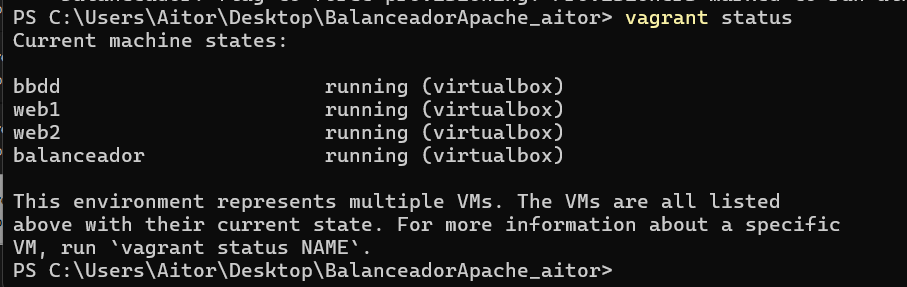

# Balanceador con Apache
**Realizado por:** Aitor Guerrero
**Dominio:** https://balanceadorAITOR.duckdns.org

## Índice
 
1. [Introducción](#1-introducción)
2. [Esquema de la infraestructura](#2-esquema-de-la-infraestructura)
3. [Vagrantfile](#Vagrantfile)
4. [Scripts](#Scripts)
5. [Seguridad](#5-seguridad)
6. [IP pública y dominio](#6-ip-pública-y-dominio)
7. [Certificado HTTPS](#7-certificado-https)
8. [Comprobación final](#8-comprobación-final)
9. [Vídeo de demostración](#9-vídeo-de-demostración)
---
 
## 1. Introducción
El objetivo de la práctica es crear un escenario de tres niveles con un balanceador apache:
 
- **Capa 1 (red pública):** un balanceador con Apache que recibe las peticiones.
- **Capa 2 (red privada):** dos servidores web con Apache.
- **Capa 3 (red privada):** un servidor de base de datos con MariaDB.
Solo el balanceador es accesible públicamente. Tiene un nombre de dominio y un certificado válido de Let's Encrypt.
 
Herramientas utilizadas: **VirtualBox** (máquinas virtuales), **Vagrant** (creación automática de las máquinas), **Ubuntu 22.04**, **Apache**, **MariaDB**, **Certbot** y **DuckDNS** (dominio gratuito).

## 2. Esquema de la infraestructura
| Máquina | Capa | IP |
|---|---|---|
| AitorGuerreroBalanceador | 1 | 192.168.1.200 (pública) y 192.168.20.10 |
| AitorGuerreroWeb1 | 2 | 192.168.20.11 y 192.168.30.11 |
| AitorGuerreroWeb2 | 2 | 192.168.20.12 y 192.168.30.12 |
| AitorGuerreroBBDD | 3 | 192.168.30.10 |

## 3. Vagrantfile
El archivo describe las cuatro máquinas: su nombre, su memoria, sus redes y el script que las configura. Todas usan la imagen `ubuntu/jammy64` (Ubuntu 22.04).

Al principio del archivo se definen dos variables: `NOMBRE`, que guarda mi nombre y se usa para nombrar a las máquinas (`AitorGuerreroBalanceador`, `AitorGuerreroWeb1`, etc.), e `IP_PUBLICA`, que es la IP fija del balanceador en mi red local (`192.168.18.200`). Todas las máquinas parten de la misma imagen, Ubuntu 22.04 (`ubuntu/jammy64`). Además, se ha ampliado el tiempo máximo de arranque a 10 minutos (`boot_timeout = 600`) para que Vagrant no dé error si una máquina tarda en iniciarse (me ha pasado varias veces), y se ha configurado VirtualBox para mostrar la ventana de cada máquina (`vb.gui = true`) y para desactivar el puerto serie virtual, ya que en Ubuntu 22.04 puede bloquear el arranque.

A continuación se crean las máquinas, empezando por la capa 3. La máquina `bbdd` tiene 1024 MB de memoria, está conectada solo a la red privada `red_bbdd` con la IP `192.168.30.10` y ejecuta el script `bbdd.sh`. Después, un bucle (`(1..2).each`) que crea los dos servidores web con el mismo código: cada uno tiene dos redes, `red_web`, para comunicarse con el balanceador, y `red_bbdd`, para comunicarse con la base de datos. Al script `web.sh` se le pasa el número del servidor y mi nombre, de forma que cada página web indique qué servidor está respondiendo. Por último se define el `balanceador`, que tiene también dos redes: una pública en modo puente, con la IP pública 192.168.18.200, y una privada (`red_web`) con la IP `192.168.20.10`. Su script es `balanceador.sh`.  

## 4. Scripts
Cada máquina se configura automáticamente con un script de la carpeta provision:
 
| Script | Qué hace |
|---|---|
| `balanceador.sh` | Instala Apache y Certbot, configura el reparto de visitas (mod_proxy_balancer) entre Web1 y Web2 y activa el cortafuegos |
| `web.sh` | Instala Apache, crea una página que indica qué servidor es y activa el cortafuegos |
| `bbdd.sh` | Instala MariaDB, crea la base de datos `tarea` y el usuario `app`, y activa el cortafuegos |

Para comprobar que los servicios funcionan, entraremos en cada máquina y comprobaremos su status:
  
  
  
  

## 5. Seguridad
 
Se usa el cortafuegos **UFW**, para que bloquee todo el tráfico de entrada salvo el necesario. Además, cada capa está en una red distinta, por lo que el balanceador no puede llegar a la base de datos.
 
| Máquina | Tráfico permitido |
|---|---|
| Balanceador | Puertos 80 y 443 desde cualquier máquina |
| Web1 y Web2 | Puerto 80 solo desde el balanceador |
| BBDD | Puerto 3306 solo desde Web1 y Web2 |

## 6. IP pública y dominio
 
1. El balanceador tiene una interfaz en modo puente con una IP fija de la LAN.
2. En el router se redirigen los puertos **80 y 443** hacia esa IP.
3. En DuckDNS se crea el subdominio `balanceadorAITOR.duckdns.org` apuntando a la IP pública del router.
